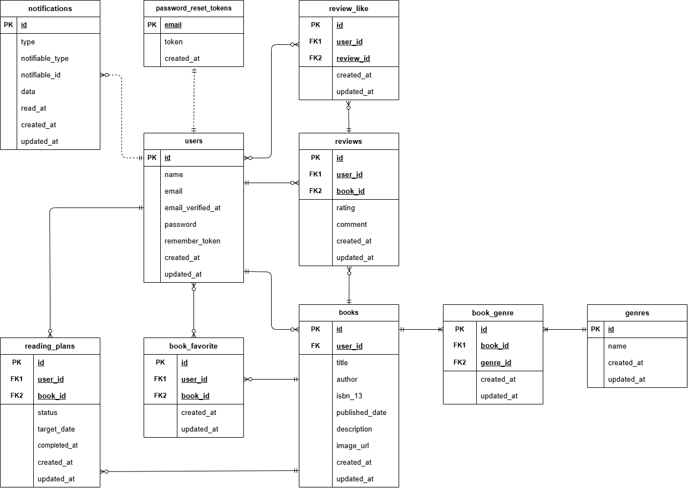

# プロジェクト名：BookShelf 書籍レビューアプリ

## 概要
Laravelを用いて開発した書籍レビュー管理アプリです。<br>
ユーザーは書籍を登録・閲覧し、レビューの投稿やお気に入り登録ができます。<br>
ジャンルによる分類やレビューへのいいね機能、平均評価に基づくランキング機能も備えています。<br>

### 書籍関連の機能
書籍の登録、編集、削除が可能。登録した書籍は一覧に表示され、クリックすると詳細に遷移します。<br>
書籍詳細には、タイトルの情報と、登録者のレビュー、閲覧者のレビュー、レビューに対するいいね件数、などが確認できます。<br>

### ランキングの表示
平均評価が4以上のタイトルがランキング一覧に表示されます。<br>

### お気に入り一覧
書籍詳細のハートマークをクリックするとお気に入り登録され、お気に入り一覧に表示されます。<br>

### ジャンル関連の機能
ジャンルの登録、編集、削除が可能。登録したジャンルはジャンル一覧に表示されます。<br>
ジャンル名をクリックすると、該当ジャンルを紐づけている書籍が表示されます。<br>

### マイレポート
ログインユーザーのレビュー傾向や、読了件数が表示されます。<br>

### 読書計画の機能
読書計画の登録、編集、削除、完了が可能。登録した読書計画は読書計画一覧に表示されます。<br>
読書計画を登録する際に期日を設定します。作成時のステータス（状態）は「進行中」、完了すると「読了」に変更されます。期日を過ぎた場合は「期日超過」に変更されます。<br>
「期日超過」は日次バッチと連動する為、リアルタイム性はありません。<br>

### 通知の機能<br>
読書計画で設定した期日に応じた通知が行われます。<br>
通知の対象は「期日3日前」、「期日当日」、「期日3日後」の3パターンです。<br>
日次バッチは20時の設定になっています。該当する通知は通知一覧に表示されます。<br>

## 機能
### 未ログインで可能
- 書籍一覧表示
- 書籍：検索（キーワード検索：タイトル、著者 ・ ジャンル選択 ・ ソート）
- 書籍：詳細ページ表示
- ランキング表示

### 会員登録・ログインが必要
- 書籍：登録
- 書籍：編集
- 書籍：削除
- お気に入り：登録
- お気に入り：解除
- レビュー：投稿
- レビュー：編集
- レビュー：削除
- ジャンル：登録
- ジャンル：編集
- ジャンル：削除
- マイ読書レポート
- 読書計画：登録
- 読書計画：編集
- 読書計画：削除
- 読書計画：完了

## ER図


## 環境構築手順

※ Docker Desktop を起動した状態で以下の手順を実行してください。<br>

### 1. リポジトリをクローン

```bash
git clone git@github.com:TakakazuSekiguchi/bookshelf-app.git bookshelf-app
cd bookshelf-app
```

### 2. `.env` ファイルを作成

```bash
cp .env.example .env
```

`.env` ファイルを開き、以下のデータベース接続情報を設定します。<br>

```env
DB_CONNECTION=mysql
DB_HOST=mysql
DB_PORT=3306
DB_DATABASE=laravel
DB_USERNAME=sail
DB_PASSWORD=password

# Dockerコンテナ内のユーザー・グループID
WWWUSER=1000
WWWGROUP=1000
```

※ WWWUSER・WWWGROUPは、ホストPCのユーザーID・グループIDに合わせて設定してください。Ubuntuなどでは1000が一般的ですが、環境によって異なります。<br>

### 3. Composerで依存パッケージをインストール

```bash
docker run --rm \
    -u "$(id -u):$(id -g)" \
    -v "$(pwd):/var/www/html" \
    -w /var/www/html \
    -e COMPOSER_CACHE_DIR=/tmp/composer_cache \
    laravelsail/php82-composer:latest \
    composer install
```

### 4. Dockerコンテナを起動

```bash
docker compose up -d --build
```

### 5. アプリケーションキーを生成

```bash
./vendor/bin/sail artisan key:generate
```

### 6. マイグレーション・初期データ登録

```bash
./vendor/bin/sail artisan migrate
./vendor/bin/sail artisan db:seed
```

### 7. Node.jsの依存パッケージをインストール

```bash
./vendor/bin/sail npm install
```

### 8. Viteを起動（画面表示に必要）

```bash
./vendor/bin/sail npm run dev
```

※ 画面を表示する際は、Viteを起動したターミナルを開いたままにしてください。<br>

### 9. 日次バッチの実行

#### 手動実行

```bash
./vendor/bin/sail artisan reading-plans:daily-batch
```

#### スケジュール実行

```bash
./vendor/bin/sail artisan schedule:work
```

※ スケジュール実行中はターミナルを開いたままにしてください。<br>
※ リマインダー通知の動作確認を行う場合は、対象時刻より前に実行してください。<br>

## 使用技術（実行環境）
- PHP 8.5.12
- Laravel 10.50.3
- MySQL 8.4.9
- Docker
- Laravel Sail
- Laravel Fortify
- Laravel Sanctum
- PHPUnit
- phpMyAdmin
- Postman

## 作成者
関口 隆和<br>

## APIエンドポイント一覧
| HTTPメソッド | エンドポイント | 機能 | 認証 |
|:---:|---|---|:---:|
| GET | `/api/v1/books` | 書籍一覧 | 不要 |
| GET | `/api/v1/books/{book}` | 書籍詳細 | 不要 |
| POST | `/api/v1/books` | 書籍登録 | 必要 |
| PUT / PATCH | `/api/v1/books/{book}` | 書籍更新 | 必要 |
| DELETE | `/api/v1/books/{book}` | 書籍削除 | 必要 |

## 開発環境URL
- phpMyAdmin：http://localhost:8080/
- 会員登録画面：http://localhost/register
- ログイン画面：http://localhost/login
- 書籍一覧画面：http://localhost/books
- 書籍詳細画面：http://localhost/books/{book}
- 書籍登録画面：http://localhost/books/create
- 書籍編集画面：http://localhost/books/{book}/edit
- ジャンル一覧画面：http://localhost/genres
- ジャンル詳細画面：http://localhost/genres/{genre}
- ジャンル登録画面：http://localhost/genres/create
- ジャンル編集画面：http://localhost/genres/{genre}/edit
- ランキング：http://localhost/ranking
- お気に入り一覧：http://localhost/favorites
- マイ読書レポート：http://localhost/reports
- 読書計画一覧画面：http://localhost/reading-plans
- 読書計画登録画面：http://localhost/reading-plans/create
- 読書計画編集画面：http://localhost/reading-plans/{plan}/edit
- 通知一覧画面：http://localhost/notifications

## ログイン情報（動作確認用アカウント）
### テストユーザー

| 名前 | メールアドレス | パスワード |
|---|---|---|
| 山田太郎 | yamada@example.com | password |
| 鈴木花子 | suzuki@example.com | password |
| 田中一郎 | tanaka@example.com | password |
| 佐藤美咲 | sato@example.com | password |
| 高橋健太 | takahashi@example.com | password |

※ 上記アカウントは `php artisan db:seed` 実行時に作成されます。<br>

## テスト
Unitテスト、Featureテストを中心に実装しています。<br>

### Unitテスト
- BookTest
- GenreTest
- ReadingPlanTest
- ReviewTest
- UserTest

### Featureテスト
- 認証：会員登録
- 認証：ログイン
- 認証：ログアウト
- 書籍：一覧
- 書籍：詳細
- 書籍：登録
- 書籍：編集
- 書籍：削除
- 書籍：検索
- 書籍：ソート
- ジャンル：一覧
- ジャンル：詳細
- ジャンル：登録
- ジャンル：編集
- ジャンル：削除
- お気に入り
- レビュー：投稿
- レビュー：編集
- レビュー：削除
- いいね
- ランキング
- 読書計画：登録
- 読書計画：編集
- 読書計画：削除
- 読書計画：完了
- Sanctum認証
- 公開API_書籍：一覧
- 公開API_書籍：検索
- 公開API_書籍：詳細
- 公開API_書籍：登録
- 公開API_書籍：編集
- 公開API_書籍：削除
- マイ読書レポート：認証・認可
- マイ読書レポート：基本サマリー
- マイ読書レポート：評価分布
- マイ読書レポート：高評価書籍TOP5
- マイ読書レポート：ジャンル別評価傾向TOP5
- 日次バッチ：リマインダー通知
- 日次バッチ：期限切れ更新
- 通知：取得・表示
- 通知：既読処理

## テスト環境構築手順（Laravel Sail）

### 1. テスト用データベースを作成

#### MySQLにログイン

```bash
./vendor/bin/sail exec mysql mysql -u root -p
```

パスワードは、プロジェクトの .env に設定されている以下の値を確認してください。<br>
```bash
DB_PASSWORD=パスワード
```

#### `bookshelf_test` というデータベースを作成

```sql
CREATE DATABASE bookshelf_test;
GRANT ALL PRIVILEGES ON bookshelf_test.* TO 'sail'@'%';
SHOW DATABASES;
```

※ `SHOW DATABASES;` 実行後、`bookshelf_test` が作成されていれば成功です。<br>

### 2. `.env` をコピーして `.env.testing` を作成

```bash
cp .env .env.testing
```

### 3. `.env.testing` のAPP_ENVとAPP_KEYを以下のように変更

```env
APP_ENV=test
APP_KEY=
```

※ APP_KEYはテスト用に再生成するため、一度空にしてください。<br>
その後、後述のコマンド（key:generate）でテスト用キーを生成します。<br>

### 4. `.env.testing` のDB設定を以下のように変更

```env
DB_CONNECTION=mysql
DB_HOST=mysql
DB_PORT=3306
DB_DATABASE=bookshelf_test
DB_USERNAME=sail
DB_PASSWORD=password
```

※【重要】開発用データベースと分離するため、テスト専用DBを使用しています。<br>
必ず `DB_DATABASE=bookshelf_test` に書き換えるようお願いいたします。<br>

※ DB_USERNAMEとDB_PASSWORDは、`.env` のMySQL接続設定と一致させてください。<br>

### 5. テスト用データベースのマイグレーション

```bash
./vendor/bin/sail artisan key:generate --env=testing
./vendor/bin/sail artisan migrate:fresh --env=testing
```

※ `migrate:fresh` は対象データベースのテーブルをすべて削除してから再作成します。必ずテスト用データベースに接続されていることを確認してください。<br>

### テスト実行
```bash
sail artisan test
```

※ テストでは RefreshDatabase を使用し、各テスト実行ごとにDBをリセットしています。<br>

## 実装への取り組み・課題
### ISBN検索機能について
Google Books APIとの連携を確認する過程で、APIから書籍情報を取得できない事象が発生しました。<br>
原因の切り分けのため、以下の調査を実施しました。<br>

- PostmanからAPIリクエストを送信し、レスポンスを確認
- Google Books APIの公式ドキュメントを確認し、基本的な検索リクエストを検証
- `FACTFULNESS` というタイトルで検索し、HTTP 200のレスポンスと書籍情報の取得を確認
- 対象書籍のISBN（9784822289607）で検索したところ、HTTP 200が返る一方、`totalItems: 0` となり検索結果が取得できないことを確認
- 同様の事象に関する報告についても調査

一通りの調査と検証を行いましたが、解決の目処が立たないため、本機能の調査はいったん中断し、他の機能の実装を優先することにしました。<br>
API側の状況や原因について新たな情報が得られた際に、調査と動作確認の再開を予定していたのですが、他の機能実装に時間を要してしまい、ISBN検索機能については実装を断念しました。<br>